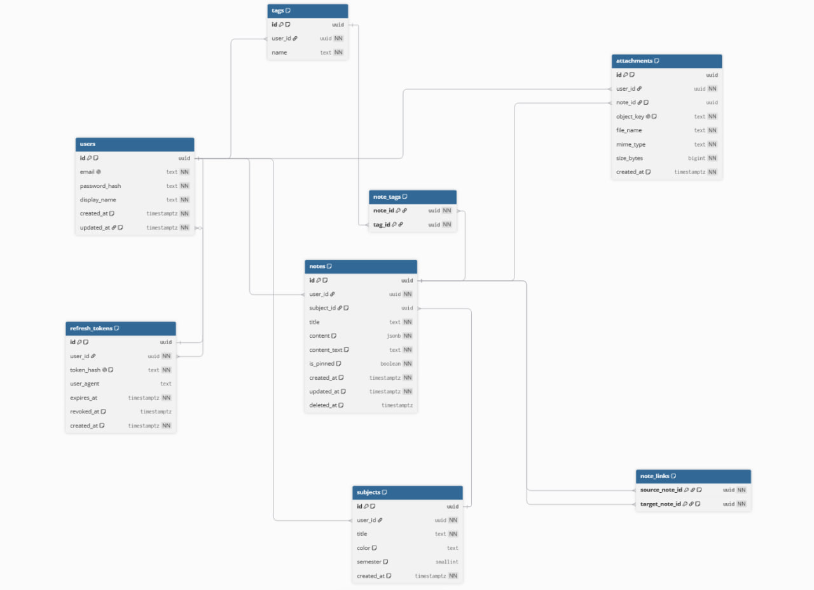

# studyvault

База знаний студента: конспекты с `[[ссылками]]` между ними, предметы, теги, полнотекстовый поиск и файлы.
Это REST API на Go; интерактивная документация открывается прямо в браузере.


## Что умеет

- **Аккаунты.** Регистрация и вход, access JWT на 15 минут, refresh-токен в httpOnly cookie с ротацией:
  использованный токен второй раз отзывает всю сессию (защита от кражи), logout отзывает токен.
- **Предметы и заметки.** Заметки хранятся как документы редактора Tiptap (JSON). Мягкое удаление,
  постраничный список по курсору, фильтры по предмету, тегу и закреплению.
- **Теги.** Свои у каждого пользователя; набор тегов заметки заменяется атомарно.
- **Связи и граф.** Ссылки `[[Название заметки]]` в тексте превращаются в связи: обратные ссылки и граф
  заметок. Ссылка на заметку, которая появится позже, подхватывается сама.
- **Поиск.** Meilisearch: русский и английский, устойчив к опечаткам, с подсветкой найденного.
  Результаты всегда перепроверяются в Postgres, чужие и удалённые заметки не просачиваются.
- **Файлы.** PDF, картинки, текст до 20 МБ. Загрузка идёт напрямую в S3-хранилище по временной ссылке,
  подпись которой привязана к заявленным типу и размеру, так что залить другое по ней нельзя.

## Стек

Go · chi · PostgreSQL (pgx, sqlc, goose) · Meilisearch · S3 (RustFS) · JWT + bcrypt ·
OpenAPI (oapi-codegen) · Docker Compose · GitHub Actions.

## Быстрый старт

Нужен только Docker.

```bash
cp .env.example .env
docker compose --profile app up -d --build
```

Поднимутся Postgres, Meilisearch, S3-хранилище, миграции и сам API. Дальше:

- **http://localhost:8080/docs** — Swagger UI: все эндпоинты, кнопка **Authorize** для токена,
  **Try it out** для запросов;
- http://localhost:8080/health — проверка сервиса и базы;
- http://localhost:8080/openapi.yaml — контракт для генерации клиентов.

Как попробовать в Swagger UI: `POST /auth/register` → скопировать `access_token` из ответа →
**Authorize** → вставить токен → пользоваться остальными эндпоинтами.

Остановить: `docker compose --profile app down` (данные сохраняются в томах).

## Разработка

Нужен Go (версия указана в `backend/go.mod`).

```bash
cp .env.example .env
docker compose up -d                      # только инфраструктура
cd backend
go tool goose -dir migrations postgres "$DATABASE_URL" up   # миграции (DATABASE_URL из .env)
go run ./cmd/api                          # API на :8080, .env подхватывается сам
go test ./...                             # тесты
```

Тесты идут на настоящих Postgres, Meilisearch и S3 (транзакции откатываются, индексы и бакеты
временные). Если сервисы не подняты или переменные не заданы, соответствующие тесты пропускаются.
Перед тестами выгрузите переменные: `set -a; . ../.env; set +a`.

| Порт | Сервис |
|---|---|
| 8080 | API |
| 5440 | PostgreSQL |
| 7700 | Meilisearch |
| 9000 / 9001 | S3-хранилище / его консоль |

Полезные команды (из каталога `backend`):

```bash
go generate ./internal/httpapi/                                        # код сервера из api/openapi.yaml
docker run --rm -v "$PWD:/src" -w /src sqlc/sqlc generate              # код запросов из internal/db/queries
go run ./cmd/reindex                                                   # пересобрать поисковый индекс из базы
```

## Настройки

| Переменная | Назначение |
|---|---|
| `DATABASE_URL` | строка подключения к Postgres (обязательна) |
| `JWT_SECRET` | секрет подписи токенов, не короче 32 символов (обязателен) |
| `HTTP_PORT` | порт API, по умолчанию 8080 |
| `COOKIE_SECURE` | по умолчанию `true`: refresh-cookie уходит только по HTTPS. `false` нужен лишь для локальной работы по http |
| `CORS_ORIGINS` | адреса фронтенда через запятую; только явные, без `*` |
| `MEILI_URL`, `MEILI_MASTER_KEY` | поиск; без них `/search` отвечает 503, остальное работает |
| `S3_ENDPOINT`, `S3_ACCESS_KEY`, `S3_SECRET_KEY`, `S3_BUCKET` | файлы; без них `/attachments` отвечает 503 |
| `S3_PUBLIC_ENDPOINT`, `S3_USE_SSL`, `S3_REGION` | адрес в ссылках для клиента, если он отличается; TLS; регион |

## API

Все эндпоинты, кроме `/health`, `/docs` и `/auth/*`, требуют заголовок `Authorization: Bearer <access_token>`.
Подробности, схемы и примеры смотрите в Swagger UI.

| Метод и путь | Что делает |
|---|---|
| `POST /auth/register`, `/auth/login` | регистрация, вход |
| `POST /auth/refresh`, `/auth/logout` | обновление токена (cookie), выход |
| `GET /subjects`, `POST /subjects` | список и создание предметов |
| `PATCH /subjects/{id}`, `DELETE /subjects/{id}` | изменение и удаление предмета |
| `GET /notes`, `POST /notes` | список (по курсору, с фильтрами) и создание заметки |
| `GET /notes/{id}`, `PATCH /notes/{id}`, `DELETE /notes/{id}` | заметка целиком, изменение, мягкое удаление |
| `PUT /notes/{id}/tags` | заменить набор тегов заметки |
| `GET /notes/{id}/backlinks` | заметки, которые ссылаются на эту |
| `GET /graph` | граф связей между заметками |
| `GET /tags`, `POST /tags`, `DELETE /tags/{id}` | теги |
| `GET /search?q=` | полнотекстовый поиск |
| `POST /attachments` | зарегистрировать файл, получить ссылку для загрузки |
| `GET /attachments?note_id=`, `GET /attachments/{id}`, `DELETE /attachments/{id}` | файлы заметки, ссылка на скачивание, удаление |

**Загрузка файла** идёт в три шага: `POST /attachments` возвращает `upload_url` → клиент делает `PUT` на этот адрес
с теми же `Content-Type` и `Content-Length`, которые заявил (без токена) → `GET /attachments/{id}` отдаёт ссылку на скачивание.

Ошибки всегда имеют вид `{"error": {"code": "...", "message": "..."}}`. Чужие заметки, предметы, теги
и файлы отвечают 404, как и несуществующие.

## Схема базы данных



Исходник схемы для dbdiagram.io: [backend/db/schema.dbml](backend/db/schema.dbml).
Миграции: [backend/migrations](backend/migrations).

## Устройство проекта

```
backend/
  cmd/api, cmd/reindex     точки входа
  api/openapi.yaml         контракт API (источник правды для сгенерированного кода)
  internal/
    httpapi/               HTTP: маршруты, проверка входных данных, ответы
    auth, subject, note,   доменная логика; HTTP о ней ничего не знает,
    tag, attachment,       а базу и внешние сервисы она получает через интерфейсы
    search, storage
    db/                    запросы на SQL (sqlc) и сгенерированный код
    config/                настройки из переменных окружения
  migrations/              миграции goose
```

## Безопасность

Пароли хранятся как bcrypt, refresh-токены только в виде sha256, JWT принимается только с алгоритмом HS256 и
обязательным сроком. Все данные привязаны к пользователю на уровне SQL. Ответы API не кэшируются, весь текст
в сниппетах поиска экранирован, а загруженные файлы отдаются как вложения из белого списка типов
(без HTML и SVG). Тесты проверяют изоляцию пользователей на настоящей базе и ломались намеренно (мутациями),
чтобы убедиться, что они действительно ловят утечки.
